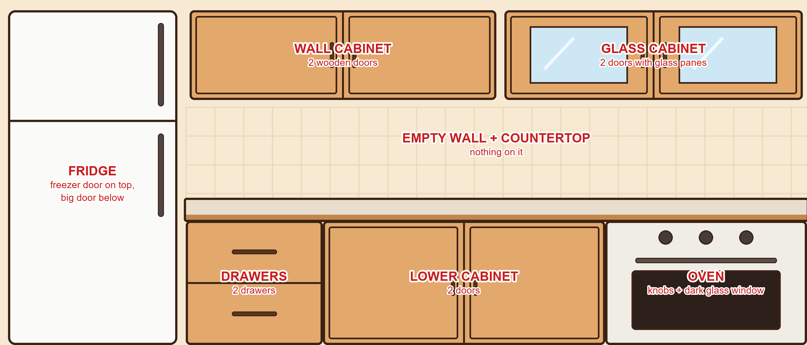

# Cała kuchnia jako jeden obrazek: prompt dla Gemini

Gra potrzebuje teraz **jednego obrazka całej kuchni**: lodówki, szafek, blatu, szuflad, piekarnika i ściany. Wtedy wszystko jest połączone, ma ten sam styl i nie ma osobnych ramek. Gra sama tnie ten obrazek na drzwi, które się otwierają.

**Jak to zrobić:**
1. Wejdź na gemini.google.com i wybierz tworzenie obrazów.
2. Wgraj **3 obrazki** naraz:
   - `makieta-kuchni.png` (jest w folderze `szarlotka`; pokazuje, gdzie co stoi),
   - `img/manzanas.png` i `img/queso.png` (wzory stylu).
3. Wklej prompt z sekcji niżej.
4. Jeśli obrazek wyjdzie kwadratowy albo meble będą w innych miejscach, napisz: „Keep the exact 21:9 shape and put every piece exactly where it is in the layout image.”
5. Gotowy obrazek wklej mi w czacie. Zapiszę go jako `img/kuchnia.jpg` i dopasuję miejsca drzwi do tego, co narysuje Gemini.



## Prompt

```
I attached 3 images.
Image 1 is a LAYOUT SKETCH of a kitchen (21:9, very wide). Image 2 and 3 show the ART STYLE.

Draw ONE finished picture of this kitchen, seen straight from the front (no perspective, flat like a
game background), in EXACTLY the art style of images 2 and 3: cute cartoon, thick dark-brown outlines,
flat warm colors with one simple highlight, rounded friendly shapes, like a casual cooking game.

Keep the layout EXACTLY like image 1: same 21:9 shape, every piece in the same place and the same size.
- Left: a tall white two-door fridge (small freezer door on top, big door below), standing on the floor.
- Top: two wall cabinets side by side, both with 2 doors that meet in the middle (handles in the middle).
  The left one has plain wooden doors. The right one is a glass cabinet: each door is a wooden frame
  with a big glass pane in the middle, exactly where the light-blue panes are in image 1. Behind the
  glass draw only an empty, slightly darker cabinet inside (no objects).
- Middle: an EMPTY wall with warm cream tiles, and below it ONE long light-stone countertop that runs
  from the fridge to the right edge. Nothing on the countertop and nothing on the wall.
- Under the countertop, touching each other with no gaps: a drawer unit with 2 drawers, a lower cabinet
  with 2 doors, and a white built-in oven with 3 knobs on top and a big dark glass window.
All cabinets are the same light honey-oak wood with dark-brown handles. Everything is joined into one
kitchen: the countertop sits directly on the lower cabinets, no frames or borders around the countertop.
The wall around the furniture is one calm, plain warm-cream color right up to the edges of the picture.

Do NOT copy the red labels from the sketch. No text, no letters, no people, no plants, no objects,
no window, no lamps.
```

## Co robi gra z tym obrazkiem

- Kuchnia ma zawsze proporcje 21:9. Wolne miejsce po bokach dostaje kolor ściany z obrazka, więc nie widać krawędzi.
- Każde drzwi to wycięty kawałek obrazka. Tak się otwierają:
  - **Szafki z 2 drzwiami:** oba skrzydła odchylają się na boki, każde na swoich zawiasach, i zostają otwarte. Ich tył jest ciemniejszy.
  - **Witryna (szklane drzwiczki):** przez szybę od razu widać prawdziwe rzeczy, które są w środku.
  - **Lodówka:** drzwi odchylają się w lewo.
  - **Szuflady:** wysuwają się w dół.
  - **Piekarnik:** pokrętła zostają, opada tylko klapa z szybą i widać ciemne wnętrze, a przy pieczeniu żar.
- Blat nie ma własnego tła, widać po prostu blat z obrazka. Rzeczy stoją na jego przedniej krawędzi.
- Lodówka ma zawsze ten sam rozmiar, otwarta i zamknięta.
- Dopóki nie ma `img/kuchnia.jpg`, gra używa obecnych osobnych mebli w tym samym układzie.

# Rzeczy na blacie, widok z góry: 2 plansze dla Gemini

W zbliżeniu blat jest widziany z góry, tak jak deska, miska i patelnia (`tablaTop`, `bolTop`, `sartenTop`). Składniki i narzędzia obok muszą być narysowane tak samo, jakby naprawdę leżały na blacie.

**Jak to zrobić:** do każdej planszy wgraj jako wzór `img/bolTop.png`, `img/tablaTop.png` i `img/manzanas.png`, a potem wklej prompt. Gotowe plansze wklej mi w czacie.

## Plansza 1: składniki (siatka 3 × 3)

```
I attached 3 images. They show the ART STYLE and the CAMERA ANGLE: cute cartoon, thick dark-brown
outlines, flat warm colors with one simple highlight, seen from DIRECTLY ABOVE (top-down flat lay),
like objects lying on a kitchen countertop.

Draw ONE picture: a 3 x 3 grid of 9 separate objects on a plain pure white background, lots of empty
white space between them, every object the same size, all seen from directly above, in this order
(left to right, top to bottom):
1. three red apples lying together
2. a small round bowl full of yellow corn flour
3. a small round bowl full of white potato starch
4. a small round bowl full of powdered sugar (white, fluffy)
5. one whole egg next to a small bowl with one egg yolk
6. a block of butter on a small plate, unwrapped
7. a small paper sachet of baking powder with a teaspoon
8. a small paper sachet of vanilla sugar
9. three cinnamon sticks and a little pile of ground cinnamon

No shadows on the floor, no table, no text, no letters, no labels.
```

## Plansza 2: narzędzia (siatka 2 × 3)

```
I attached 3 images. They show the ART STYLE and the CAMERA ANGLE: cute cartoon, thick dark-brown
outlines, flat warm colors with one simple highlight, seen from DIRECTLY ABOVE (top-down flat lay),
like objects lying on a kitchen countertop.

Draw ONE picture: a grid of 2 rows and 3 columns, 6 separate objects on a plain pure white background,
lots of empty white space between them, all seen from directly above, lying flat, in this order
(left to right, top to bottom):
1. a kitchen knife lying diagonally
2. a vegetable peeler lying diagonally
3. a wooden spoon lying diagonally
4. a flat box grater lying on its side
5. a round fine-mesh sieve with a handle
6. a small ball of light-yellow shortcrust dough

No shadows on the floor, no table, no text, no letters, no labels.
```

Gra sama znajdzie te obrazki (`manzanasTop.png`, `harinaTop.png`… `bolaTop.png`) i pokaże je w zbliżeniu, z cieniem na blacie. Dopóki ich nie ma, zostają obecne ikonki.

# Rzeczy na blacie, widok z przodu (zwykły widok kuchni): 2 plansze dla Gemini

W zwykłym widoku kuchnia jest widziana prosto z przodu (`img/kuchnia.jpg`). Rzeczy wyjęte z szafek stoją wtedy na blacie, więc muszą być narysowane z tej samej strony: z przodu i tylko troszkę z góry, z płaskim spodem, jakby stały na stole. Wielkość względem siebie (jajko małe, tarka wysoka) ustawia gra, więc na planszy wszystkie mogą być podobnej wielkości.

**Jak to zrobić:** do każdej planszy wgraj jako wzór `img/kuchnia.jpg`, `img/manzanas.png` i `img/queso.png`, a potem wklej prompt.

## Plansza 3: składniki z przodu (siatka 3 × 3)

```
I attached 3 images. Image 1 is the KITCHEN where these objects will stand on the countertop.
Images 2 and 3 show the ART STYLE: cute cartoon, thick dark-brown outlines, flat warm colors
with one simple highlight.

Draw ONE picture: a 3 x 3 grid of 9 separate objects on a plain pure white background, lots of empty
white space between them. Every object is seen FROM THE FRONT, at eye level, only very slightly from
above, STANDING on a flat surface with a flat bottom (as if standing on the countertop of image 1).
Same perspective as the furniture in image 1. Order (left to right, top to bottom):
1. three red apples standing in a small group
2. a small round bowl full of yellow corn flour
3. a small round bowl full of white potato starch
4. a small round bowl full of powdered sugar (white, fluffy)
5. one whole egg standing in a little egg cup
6. a block of butter on a small plate
7. a small paper sachet of baking powder standing upright
8. a small paper sachet of vanilla sugar standing upright
9. a small glass jar of ground cinnamon with three cinnamon sticks

No shadows, no table, no text, no letters, no labels.
```

## Plansza 4: narzędzia z przodu (siatka 2 × 5)

```
I attached 3 images. Image 1 is the KITCHEN where these objects will stand on the countertop.
Images 2 and 3 show the ART STYLE: cute cartoon, thick dark-brown outlines, flat warm colors
with one simple highlight.

Draw ONE picture: a grid of 2 rows and 5 columns, 10 separate objects on a plain pure white background,
lots of empty white space between them. Every object is seen FROM THE FRONT, at eye level, only very
slightly from above, resting on a flat surface with a flat bottom (as if on the countertop of image 1).
Same perspective as the furniture in image 1. Order (left to right, top to bottom):
1. a kitchen knife lying flat, seen from the side
2. a vegetable peeler lying flat, seen from the side
3. a wooden spoon lying flat, seen from the side
4. a tall box grater standing upright
5. a round fine-mesh sieve with a handle, lying on its rim
6. a small ball of light-yellow shortcrust dough
7. a wooden cutting board with a handle, leaning upright
8. a frying pan with a long handle, seen from the side
9. a light-blue mixing bowl, seen from the side
10. a round springform baking tin, seen from the side

No shadows, no table, no text, no letters, no labels.
```

Gra sama znajdzie te obrazki (`manzanasFront.png`, `harinaFront.png`… `moldeFront.png`) i postawi je na blacie, każdą rzecz w jej prawdziwej wielkości i z cieniem.

# Szarlotka w formie na blacie, widok z przodu: plansza 5 (siatka 2 × 4)

Etapy pieczenia w zbliżeniu są widziane z góry (`moldeVacio` … `moldeCortado`). Ta plansza pokazuje te same 8 etapów z przodu, żeby forma wyglądała dobrze na blacie w zwykłym widoku kuchni.

**Jak to zrobić:** wgraj jako wzór `img/kuchnia.jpg`, `img/moldeHorneado.png` i `img/moldeCortado.png`, a potem wklej prompt.

```
I attached 3 images. Image 1 is the KITCHEN where this baking tin will stand on the countertop.
Images 2 and 3 show the ART STYLE and the CAKE: cute cartoon, thick dark-brown outlines, flat warm
colors with one simple highlight.

Draw ONE picture: a grid of 2 rows and 4 columns on a plain pure white background, lots of empty white
space between them. Every cell shows THE SAME square metal baking tin, same size, same position, same
angle: seen FROM THE FRONT and a bit from above (about 30 degrees), standing on a flat surface with
a flat bottom, so you can see the front side of the tin AND what is inside. Same perspective as the
furniture in image 1. Only the inside changes, step by step (left to right, top to bottom):
1. the empty tin
2. a flat layer of raw light-yellow dough pressed into the bottom
3. the dough base baked golden
4. golden fried apple pieces spread on the base
5. grated raw dough crumbs covering the apples
6. the whole cake baked golden brown with a crumbly top
7. the baked cake dusted with white powdered sugar
8. the cake with powdered sugar cut into 9 square pieces

No shadows, no table, no text, no letters, no labels.

## Plansza 5, wersja 2: forma prawie z boku (pierwsza wersja była za bardzo z góry)

Na blacie w kuchni patrzymy prawie na wysokości blatu. Widać więc głównie ściankę formy, a z ciasta tylko kawałek nad brzegiem.

```
I attached 3 images. Image 1 is the KITCHEN, seen straight from the front at eye level.
Images 2 and 3 show the ART STYLE and the CAKE.

Draw ONE picture: a grid of 2 rows and 4 columns on a plain pure white background, lots of empty white
space between them. Every cell shows THE SAME deep square metal baking tin standing on a table, same size,
same position, seen from the front at TABLE HEIGHT, only a tiny bit from above (about 10 degrees).
You mostly see the tall front metal wall of the tin; it takes about three quarters of the picture.
Of the inside you only see a THIN strip at the top, just above the rim. Same perspective as the
furniture in image 1. Only that thin strip changes, step by step (left to right, top to bottom):
1. nothing: the empty tin, you see only the far inner wall
2. a thin edge of raw light-yellow dough at the bottom, barely visible
3. a thin edge of golden baked dough, barely visible
4. golden apple pieces just peeking over the rim
5. pale crumbly dough crumbs heaped a little above the rim
6. a golden brown crumbly cake top, a little above the rim
7. the same cake top dusted with white powdered sugar
8. the same cake with sugar, with two cut lines visible in the top

No shadows, no table, no text, no letters, no labels.
```

# Plansza 6: reszta rzeczy w szafkach i lodówce, z przodu (siatka 3 × 4)

W szafkach i w lodówce rzeczy stoją na półkach, więc też muszą być narysowane z przodu, jak na planszach 3 i 4. Ta plansza to rzeczy, które są tylko „przeszkadzajkami” w meblach, i dwie kule ciasta (krok z lodówką). Gra sama ich użyje: `quesoFront.png`, `pescadoFront.png`… `masaFront.png`, `masaPequeFront.png`.

**Jak to zrobić:** wgraj jako wzór `img/kuchnia.jpg`, `img/manzanas.png` i `img/queso.png`, a potem wklej prompt.

```
I attached 3 images. Image 1 is the KITCHEN where these objects will stand on shelves and on the
countertop. Images 2 and 3 show the ART STYLE: cute cartoon, thick dark-brown outlines, flat warm
colors with one simple highlight.

Draw ONE picture: a grid of 3 rows and 4 columns, 12 separate objects on a plain pure white background,
lots of empty white space between them. Every object is seen FROM THE FRONT, at eye level, only very
slightly from above, STANDING on a flat surface with a flat bottom. Same perspective as the furniture
in image 1. Order (left to right, top to bottom):
1. a piece of yellow cheese with holes
2. a whole fish lying on its side on a small plate
3. a small tub of vanilla ice cream
4. a carton of whipping cream
5. a small bowl of strawberries
6. a red tomato
7. a brown onion
8. a small bag of rice standing upright
9. a salt shaker
10. an orange carrot lying on its side
11. a BIG ball of light-yellow shortcrust dough resting on the table (slightly flattened at the bottom)
12. a SMALL ball of the same dough resting on the table (slightly flattened at the bottom)

No shadows, no table, no text, no letters, no labels.
```

## Uzupełnienie planszy 2 (widok z góry): dwa jabłka

W zbliżeniu przy obieraniu jabłko leży na desce widzianej z góry, więc też musi być z góry. Dopisz do planszy 2 jeszcze jeden rząd (będzie siatka 3 × 3):

```
7. a whole red apple seen from directly above (round, stem and a small leaf in the middle)
8. the same apple peeled, seen from directly above (pale yellow flesh, stem in the middle)
9. a deep light-blue mixing bowl seen from directly above, so you can see it is deep (inner wall and shadow inside)
```
